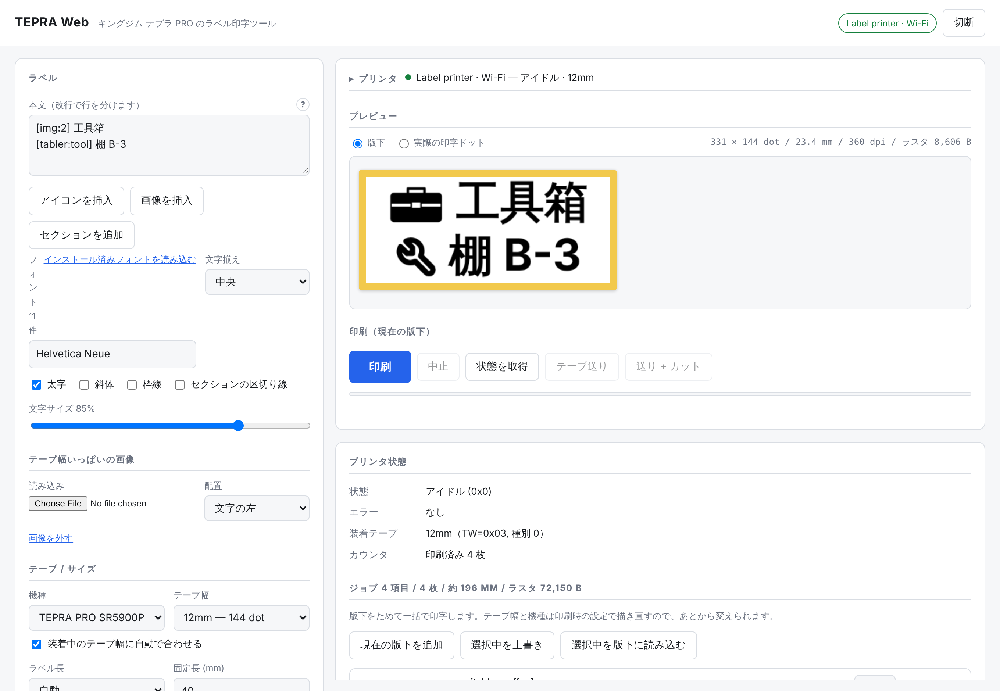
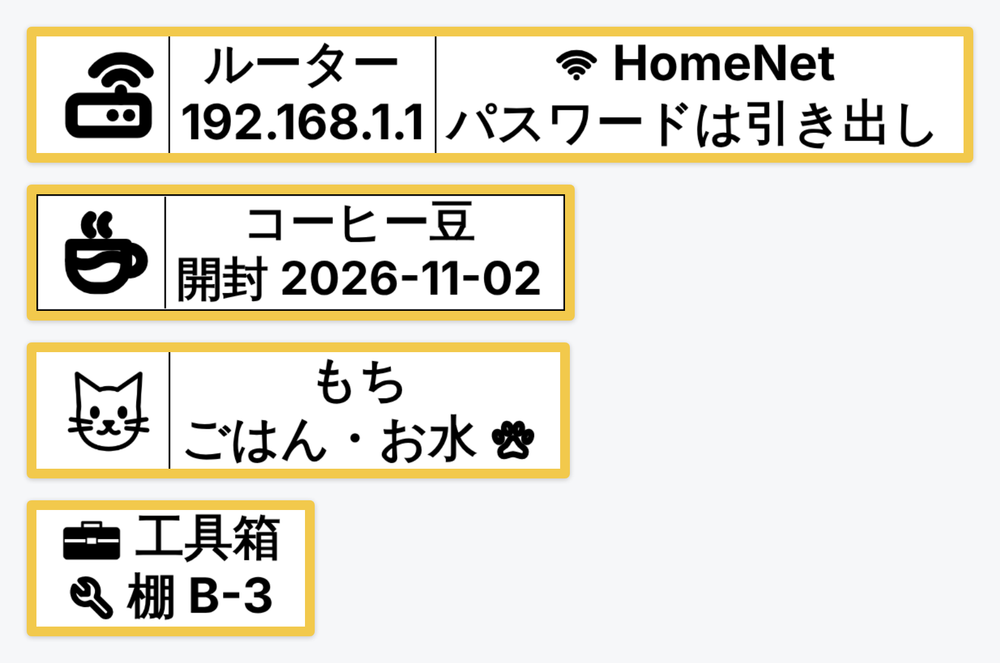
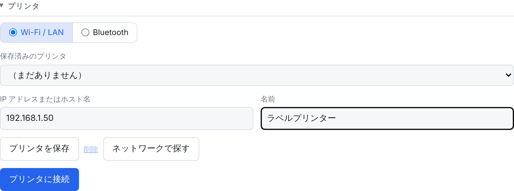
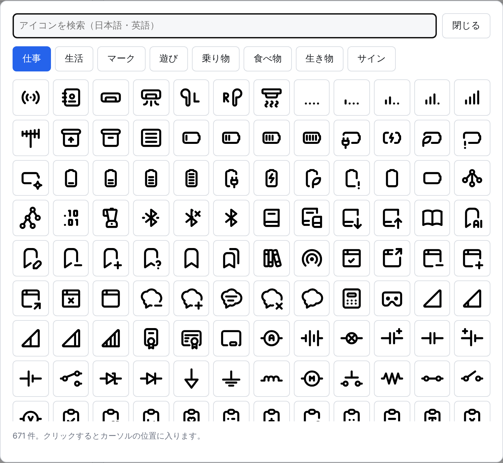
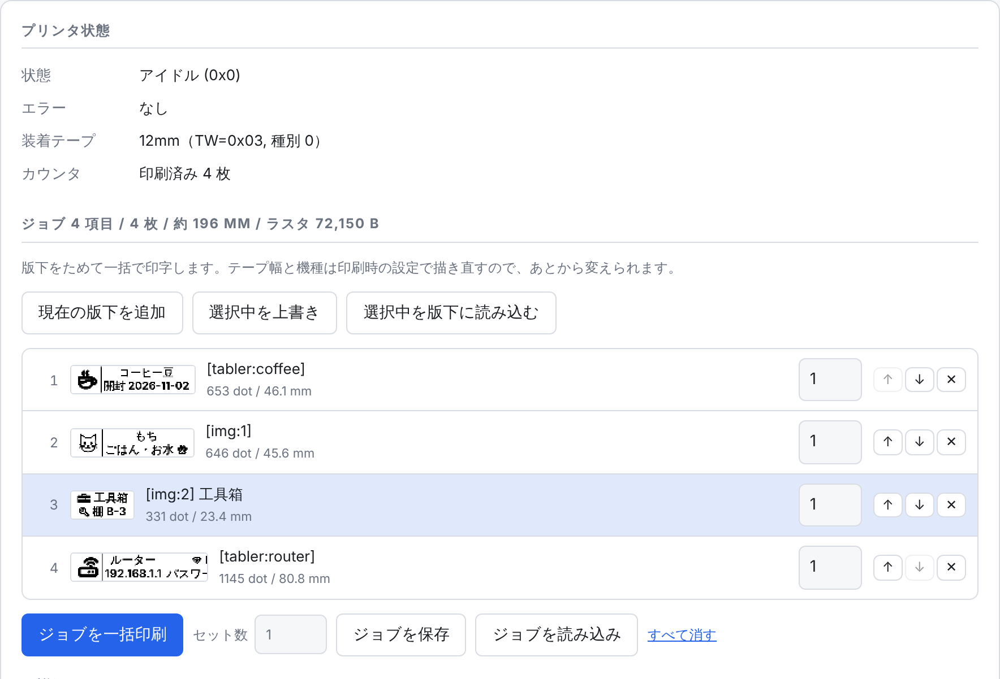
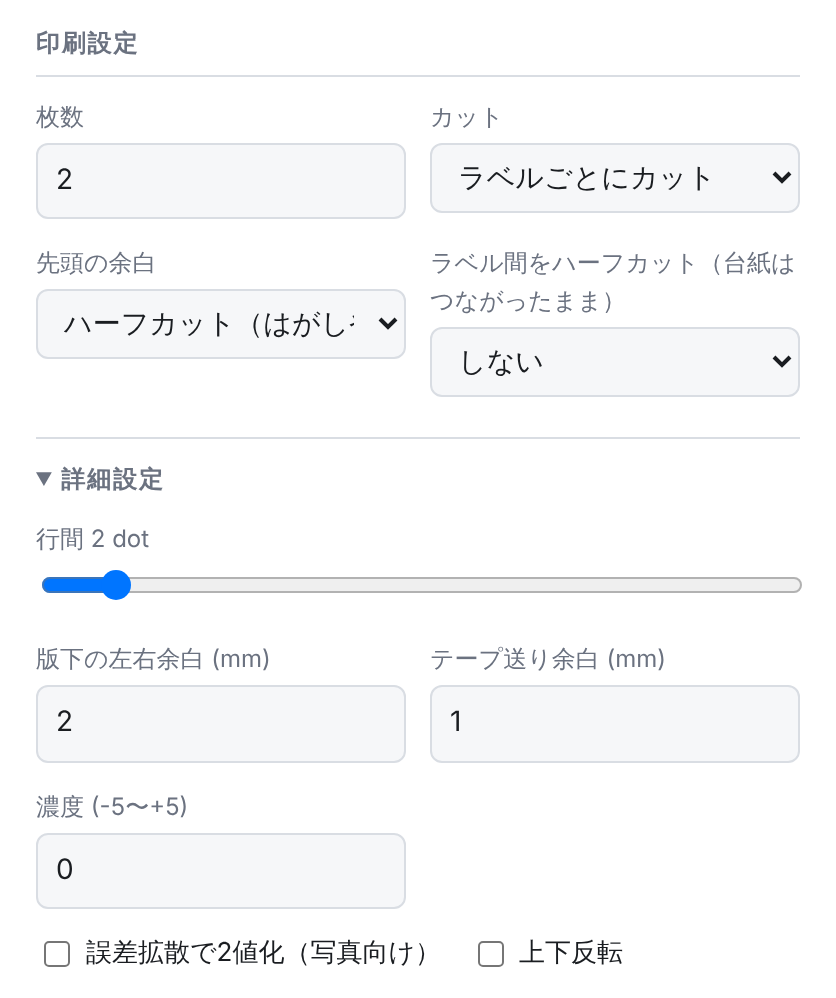

<p align="center">
  
</p>

<h1 align="center">TEPRA Web</h1>

<p align="center">
  キングジム <b>テプラ PRO</b> で、家のネットワークにあるどのブラウザからでもラベルを印刷できます。<br>
  ドライバも Windows PC もスマホアプリも要りません。
</p>

<p align="center">
  <a href="README.md">English</a> · <b>日本語</b>
</p>



TEPRA Web は家で動かす小さなサーバーです（Docker でも、Node.js だけでも動きます）。パソコンや
スマホのブラウザで開き、文字を入れてプレビューを確かめ、**印刷** を押すだけです。**SR5900P**
シリーズを **Wi-Fi / LAN** で使うために作っています。

> [!NOTE]
> **Bluetooth 対応は未検証です。** Bluetooth まわりのコード（SR-R2500P / SR-MK1 / SR-R7900P 向け）は
> 元のプロジェクトから引き継いだもので、手元に実機がないため試せていません。動くかもしれませんし、
> 動かないかもしれません。動作報告や修正は歓迎します。

## 作れるラベル



- **セクション** 行に `---` だけを書くと、ラベルが横に並んだセクションに分かれます。セクションごとに
  文字の大きさをテープ幅いっぱいに合わせるので、大きなアイコンの横に 2 行の文字を置けます。
  *セクションの区切り線* をオンにすると、間に線が入ります。
- **本文中のアイコン** 約 6,000 個。英語でも日本語でも探せます。
- **本文中の画像** ロゴ・イラスト・写真などを、*画像を挿入* でカーソルの位置に入れられます。
  大きさはその行の文字の高さに合わせます。
- パソコンに入っている **好きなフォント**（Chrome / Edge）、太字・斜体・枠線・文字揃え、
  ラベル長の自動 / 固定。
- **ジョブの一括印刷** 違うラベルをいくつもためて、まとめて印刷できます。

## はじめかた

用意するもの：

- Wi-Fi か LAN につないだテプラ PRO **SR5900P** / **SR5900C** / **SR5900GS**
- サーバーを動かす、家で常時起動しているマシン（NAS・Raspberry Pi・自宅サーバーなど）。
  **Docker** か **Node.js 18 以上** が必要です

### 1. サーバーを起動する

このリポジトリを clone したフォルダで Docker Compose を使う場合：

```bash
docker compose up -d --build
```

ブラウザで `http://<サーバーの IP>:8765/` を開きます。

<details>
<summary><b>Portainer の場合</b></summary>

1. **Stacks → Add stack**
2. **Repository** を選び、このリポジトリを指定します。compose path は `docker-compose.yml`。
   イメージは Portainer がビルドします（ビルド済みイメージは公開していません）。
3. 必要なら `TEPRA_PRINTERS`（[設定](#設定) を参照）を入れておくと、最初からプリンタが登録された状態になります。
4. Deploy して `http://<Docker ホスト>:8765/` を開きます。

</details>

<details>
<summary><b>Docker を使わない場合</b></summary>

Node.js 18 以上。Wi-Fi で印刷するだけなら `npm install` は不要です。

```bash
HOST=0.0.0.0 npm start
```

`HOST=0.0.0.0` を付けないと `127.0.0.1` でしか待ち受けないので、ほかの端末から開けません。

</details>

### 2. プリンタをつなぐ



1. プリンタ付属の設定ツールか本体の操作で、SR5900P を Wi-Fi か LAN につなぎます。
2. ルーターの接続機器一覧で IP アドレスを調べるか、**ネットワークで探す** を押します。
3. IP アドレスが変わらないよう、ルーターで **DHCP の固定割り当て** をしておきます。
4. TEPRA Web の **プリンタ → Wi-Fi / LAN** に IP アドレスを入れて **プリンタに接続** を押します。
   プリンタは次回のために保存され、テープ幅は装着中のカートリッジに合わせて自動で設定されます。

接続するとプリンタ欄は 1 行（名前・状態・装着テープ）にたたまれ、プレビューが上に来ます。

> [!TIP]
> プリンタを別の VLAN や IoT 用ネットワークに置いている場合は、サーバーからプリンタへの
> **UDP 9100** と **TCP 9100** を許可してください。

### 3. 印刷する

本文を入力します（改行で行が分かれます）。プレビューは入力に合わせて更新されます。**印刷** を押します。

進捗バーはプリンタが印刷完了を返すまで進みます。カバーが開いている・テープがない・テープ幅が
ラベルと合わない、といった場合はラベルを無駄にせず、メッセージでお知らせします。

## ラベルを作る

### セクション

`---` だけの行で新しいセクションが始まります（**セクションを追加** ボタンでも入ります）。上の
ルーターのラベルはこの本文です（[スクリーンショット](docs/images/ja/editor-sections.png)）。セクションごとに大きさを決めるので、1 行だけのアイコンは
テープ幅いっぱいに、2 行のセクションは 2 行分の大きさになります。

**ラベル長 → 固定** にすると、決めた長さに収まるよう文字が縮みます。

### アイコン



**アイコンを挿入** を押して選びます。タブは TEPRA LINK 2 と同じ並び（仕事・生活・マーク・遊び・
乗り物・食べ物・生き物・サイン）で、検索欄は日本語でも英語でも使えます（[スクリーンショット](docs/images/ja/icon-search.png)）。

アイコンはカーソルの位置に `[tabler:coffee]` のような短いコードで入り、その行の文字と同じ高さで
描かれます。コードを手で書いてもかまいません。

アイコンは [Tabler Icons](https://tabler.io/icons)・[Maki](https://github.com/mapbox/maki)・
[Phosphor](https://phosphoricons.com) のものです。

### 本文中の画像

**画像を挿入** を押してファイルを選ぶと、カーソルの位置に `[img:1]`、`[img:2]` … として入ります。
どのセクションのどの行にも入れられ、その行の文字の高さで描かれます（上の工具箱や猫の絵がそうです。[スクリーンショット](docs/images/ja/editor-image.png)）。
白黒のシンプルなイラストやロゴがきれいに出ます。

画像は追加するときに縮小され（高さ最大 512 px）、ラベルやジョブのファイルと一緒に保存されるので、
再読み込みしても消えません。

テープ幅いっぱいの高さでロゴを文字の横に置きたいときは **テープ幅いっぱいの画像** を使います。
写真は **詳細設定** の *誤差拡散で2値化（写真向け）* をオンにしてください。

### 実際に印字されるもの

プレビューを **版下** から **実際の印字ドット** に切り替えると、プリンタに送られるドットそのものを確認できます（[スクリーンショット](docs/images/ja/label-dots.png)）。

## ジョブの一括印刷



違うラベルをまとめて印刷するには：

1. ラベルを作って **現在の版下を追加** を押します。ラベルの数だけ繰り返します。
2. 項目ごとに枚数を決め、矢印で順番を入れ替えます。
3. **ジョブを一括印刷** を押します。**セット数** を増やすと、ジョブ全体をその回数だけ印刷します。

**ジョブを保存** でジョブを JSON ファイルとしてダウンロードし、**ジョブを読み込み** で戻せます。
項目は版下の設定だけを持つので、12mm テープ用に作ったジョブを 18mm テープでもそのまま印刷できます。
項目を直すには **選択中を版下に読み込む** と **選択中を上書き** を使います。

編集中のラベル・印刷設定・ジョブはブラウザに保存されるので、再読み込みしたりタブを閉じたりしても消えません。

## 印刷設定



| 設定 | 内容 |
|---|---|
| **枚数** | このラベルを何枚印刷するか |
| **カット** | *ラベルごとにカット*・*ジョブ終了後にカット*・*カットしない* |
| **先頭の余白** | プリンタは最初のラベルの前に空白のテープを送り出します。*ハーフカット* はそれをはがしやすいつまみとして残し（既定）、*切り落とす* は切り離します |
| **ラベル間をハーフカット** | ラベルだけを切って台紙は切らないので、ラベルが 1 本につながったまま出てきます |
| **濃度** | -5（薄い）〜 +5（濃い） |
| **詳細設定** | 行間・左右余白・テープ送り余白・誤差拡散・上下反転 |

*装着中のテープ幅に自動で合わせる* にチェックが入っている間、**テープ幅** はプリンタのカートリッジに
合わせて変わります。装着していないテープ用にデザインしたいときは手で選べます。ただし、装着中の
テープと違う幅で作ったラベルは、サーバーが印刷を止めます。

## スマホで使う

スマホではプレビューが先頭に来て、**印刷** ボタンは画面の下に固定されます。ホーム画面に追加すると
アプリのように開けます（[スクリーンショット](docs/images/ja/phone.png)）。

画面は日本語と英語に対応しています。ブラウザの言語に合わせて切り替わり、ページ下部でも変更できます。

## 設定

環境変数で設定します（`docker-compose.yml` か、Portainer のスタック設定に書きます）。どれも省略できます。

| 変数 | 既定値 | 内容 |
|---|---|---|
| `PORT` | `8765` | HTTP ポート |
| `HOST` | Docker では `0.0.0.0`、それ以外は `127.0.0.1` | 待ち受けるアドレス |
| `DATA_DIR` | Docker では `/data`、それ以外は `./data` | 保存したプリンタ（`printers.json`）の置き場所 |
| `TEPRA_PRINTERS` | – | 起動時に登録するプリンタ。カンマ区切りの `名前=IP[:ポート][@機種]`。例：`ラベルプリンター=192.168.1.50`、`192.168.1.50,Garage=192.168.1.51@SR5900C` |
| `TEPRA_BLUETOOTH` | Docker では `0`、それ以外は有効 | `0` で Bluetooth ブリッジを無効にします |

compose ファイルは *ネットワークで探す* がプリンタにブロードキャストできるよう `network_mode: host`
を使っています。bridge ネットワークにする場合は `8765:8765` を公開し、プリンタの IP を手で入力して
ください。印刷はできますが、自動検出は使えません。

コンテナには `/healthz` を使ったヘルスチェックがあります。`docker-compose.yml` には、unhealthy に
なったコンテナを再起動する `autoheal` サービスも（コメントアウトした状態で）入っています。

> [!WARNING]
> サーバーには **ログイン機能がありません**。家のネットワークの中だけで使い、インターネットには
> 公開しないでください。外から使いたい場合は、認証付きのリバースプロキシを前に置いてください。

## スクリプトから印刷する（画像 API）

PNG を送るとそのまま印刷します。ブラウザは要りません。ホームオートメーションなどに便利です。

```bash
curl --data-binary @label.png -H 'Content-Type: image/png' \
  'http://<サーバーの IP>:8765/api/print/image?printer=192.168.1.50&copies=2&cut=each'
```

画像の高さ方向がテープの幅方向になります。テープより高い画像は縮小し、低い画像は中央に置きます。

| パラメータ | 値 |
|---|---|
| `printer` | 保存したプリンタの id・名前・IP（プリンタが 1 台だけなら省略可） |
| `copies` | 1〜99 |
| `cut` | `each`（既定）、`end`、`none` |
| `lead` | `half`（既定）：先頭の余白をハーフカットしてつまみとして残す、`cut`：切り落とす |
| `halfcut` | `1` でラベル間をハーフカット（台紙はつながったまま）。既定は `0` |
| `density` | -5〜5 |
| `tape` | テープコード（`1`=4mm `2`=6mm `3`=9mm `4`=12mm `5`=18mm `6`=24mm `7`=36mm）。既定は装着中のテープ |
| `fit` | `contain`（既定）か `fill`（テープ幅いっぱいまで拡大） |
| `rotate` | `1` で画像を 90° 回転 |
| `invert` | `1` で白黒反転 |
| `padding`、`margin` | 両端の余白 mm（既定 2）／テープ送り余白 mm（既定 1） |

ほかのエンドポイント：`GET /api/net/status?printer=…`、`GET /api/net/discover`、`GET /api/printers`、
`GET /healthz`。

## Bluetooth（未検証）

**SR-R2500P**・**SR-MK1**・**SR-R7900P** 向けの Bluetooth Classic（RFCOMM）接続は
[nikachu2012/tepra_web](https://github.com/nikachu2012/tepra_web) からそのまま引き継いでいます。
Bluetooth のテプラを持っていないので、このフォークでは試せていません。

使えるのは、プリンタとペアリングしたパソコンで **Docker を使わずに** サーバーを動かしたときだけです：

- **macOS：** `swiftc` が必要です（`xcode-select --install` で入ります）。初回に小さなヘルパーをビルドします。
- **Linux / Windows：** オプションの `bluetooth-serial-port` パッケージが必要です（`npm install`）。

**プリンタ → Bluetooth** を選び、**デバイスを探す** を押してプリンタを選び、**プリンタに接続** を押します。
`npm run probe` で、何も印刷せずに接続だけを確かめられます。

## 困ったとき

| 症状 | 対処 |
|---|---|
| *ネットワークで探す* で見つからない | 自動検出には `network_mode: host` と、プリンタが同じサブネットにあることが必要です。IP を手で入力してください。 |
| 接続できない | IP、プリンタの電源、サーバーから UDP/TCP 9100 に届くかを確かめてください。サーバー上で `npm run netprobe -- <プリンタの IP>` を実行すると状況がわかります。 |
| 「Loaded tape is … but the label was laid out for …」と出る | ラベルが装着中と違うテープ幅で作られています。*装着中のテープ幅に自動で合わせる* をオンにするか、装着中のテープ幅を選んでください。 |
| フォントの一覧が少ない | *インストール済みフォントを読み込む* は Chrome か Edge で、`https://` か `localhost` で開いたときだけ使えます。`http://<LAN の IP>` では、よく使われるフォントの一覧になります。 |
| **テープ送り** / **送り + カット** が押せない | 今のところ Bluetooth 専用です。Wi-Fi では *カット：ラベルごとにカット* で印刷してください。 |

## 対応プリンタ

| プリンタ | 接続 | 状況 |
|---|---|---|
| SR5900P / SR5900C / SR5900GS | Wi-Fi / LAN | 対応。SR5900P で確認済み |
| SR-R2500P / SR-MK1 / SR-R7900P | Bluetooth Classic | 未検証（実機なし） |
| SR-R5600 シリーズ（BLE のみ）、SR5500P | – | 非対応 |

---

## 開発者向け

### 全体の構成

```
  スマホ / PC のブラウザ  ──HTTP──▶  TEPRA Web サーバー (Node.js)  ──UDP+TCP 9100──▶  SR5900P
  (エディタ, プレビュー,              (印刷セッション, 状態取得,
   ラスタ + コマンド生成)              保存済みプリンタ, 画像 API)
```

ラベルのレイアウト、1 ビットのラスタへの変換、プリンタ向けコマンド列の組み立てはブラウザ側
（`app/`）で行います。サーバー（`server/`）はプリンタとの印刷セッションを開いてジョブを流します。
Wi-Fi 印刷に実行時の npm 依存はありません。`bluetooth-serial-port` は Bluetooth ブリッジだけが使う
オプションの依存です。

| パス | 中身 |
|---|---|
| `index.html`, `app/` | Web UI：エディタ、レイアウト（`layout.js`）、ラスタ（`raster.js`）、コマンド列（`protocol.js`）、多言語化 |
| `app/icons.json` | アイコンデータ。`scripts/build-icons.mjs` で生成（更新方法はそのファイル冒頭のコメント） |
| `server/index.js` | HTTP サーバー、API、状態とログを流す Server-Sent Events |
| `server/network.js` | SR5900P の Wi-Fi / LAN プロトコル |
| `server/rfcomm.js`, `server/native/` | Bluetooth ブリッジ（macOS 用ヘルパーは Swift） |
| `test/` | ユニットテストと SR5900P のエミュレータ |
| `PROTOCOL.md` | コマンドの詳しい資料 |

### プリンタなしで試す

`test/fake-sr5900p.mjs` は SR5900P のエミュレータです（UDP の制御プロトコルと TCP のジョブ受信）。
すべてのフレームとチェックサムを検証し、印刷したラベルを画像として保存することもできます：

```bash
npm run fake-printer -- --port 19100 --tape 5 --dump ./fake-out
```

```bash
TEPRA_PRINTERS="Fake=127.0.0.1:19100" npm start
```

この README のスクリーンショットは、このエミュレータにつないで撮ったものです。

```bash
npm test                                   # プロトコル, パケット, PNG, 印刷セッション, i18n, 文字レイアウト
npm run netprobe -- 192.168.1.50           # 実機と通信：状態を見るだけで印刷はしない
npm run netprobe -- 192.168.1.50 --test    # 30 mm のテストパターンを印刷
npm run netprobe -- 192.168.1.50 --test --lead cut --t-margin   # 比較用：以前のカット動作
npm run netprobe -- --discover
```

実機での最初の確認には `npm run netprobe` がいちばん手軽です。20 バイトの生の状態と、テープを
認識しているかを表示します。`--test` を付けると、送った `C`（カット）フレームも表示します。
`--lead cut` は先頭の余白をハーフカットせずに切り落とし、`--halfcut` と `--copies N` でラベル間の
ハーフカットを試せます。`--t-margin` はテープ送り余白を空白の行ではなく、公式ソフトと同じく `T`
コマンドで送ります。

### Wi-Fi 印刷のしくみ

SR5900 シリーズは UDP と TCP の両方で 9100 番ポートを待ち受けています。UDP パケットはすべて 32 バイトの
ヘッダで始まります：`"TPRT"`、`0`、`1`、`0x20`、コマンド、ペイロード長、ゼロのワードが 2 つ。
各フィールドはビッグエンディアンの u32 です。応答は `"tprt"` で始まります。

| UDP コマンド | 応答 | 意味 |
|---|---|---|
| `0x0001` | 20 バイトの状態 | `[1]` 状態（2 = 印刷中）、`[2]` エラー、`[3]` テープコード、`[12..13]` 印刷枚数 |
| `0x0002` | `02 00 00` | 印刷セッションの開始 / ロック |
| `0x0101`、`0x0100` | –、`10` | データ送信の予告 |
| `0x0003` | `03 00 00` | セッションの終了 / ロック解除 |

1 回の印刷は：状態取得（アイドル・エラーなし・テープ幅一致であること）→ ロック → TCP 接続 →
`0x0101` / `0x0100` → ジョブ送信 → 完了まで状態をポーリング → ロック解除 → TCP 切断。データ接続は
セッションの間ずっと開いたままにし、エラーのときも必ずロックを解除します。TCP で送るジョブは通常の
テプラのコマンド列（`@ {ST C D G | L T H s ラスタ FF | … @`）で、公式ソフトが送るものとバイト単位で
同じです。`test/network.test.mjs` が hikalium/sr5900p のキャプチャと照合しています。
`server/network.js` と `app/protocol.js` の `buildNetworkJobBytes()` を参照してください。

コマンドの詳しい資料は [PROTOCOL.md](PROTOCOL.md) にあります。

### 既知の制限

- **テープ送り** と **送り + カット** は Bluetooth 専用です。Wi-Fi での手順はまだ取れていません。
- 自動検出はブロードキャストを使うので、host ネットワークで同じサブネットにあるときだけ動きます。
- SR-R5600 シリーズ（BLE のみ）と SR5500P には対応していません。

## クレジット

- [nikachu2012/tepra_web](https://github.com/nikachu2012/tepra_web)（MIT）：エディタ、TEPRA LINK 2
  を解析したラスタ / コマンド生成、Bluetooth ブリッジ。このプロジェクトはこのコードをもとにしています。
- [takonomura/tepra-web](https://github.com/takonomura/tepra-web) と
  [hikalium/sr5900p](https://github.com/hikalium/sr5900p)（MIT）：SR5900P の Wi-Fi プロトコル
  （UDP の制御パケットとセッションの手順）。[Mine02C4 さんの解析](https://github.com/Mine02C4/TEPRA_PRO_SR5900P_analysis)
  にもとづくものです。ここでのネットワーク部分は、このプロトコルを JavaScript で新たに実装したものです。
- アイコン：[Tabler Icons](https://tabler.io/icons)（MIT）、[Maki](https://github.com/mapbox/maki)（CC0）、
  [Phosphor Icons](https://phosphoricons.com)（MIT）。ブランドロゴは除いています。
  [THIRD_PARTY_LICENSES.md](THIRD_PARTY_LICENSES.md) を参照してください。

[MIT ライセンス](LICENSE) で公開しています。

非公式のツールで、キングジムとは関係ありません。
