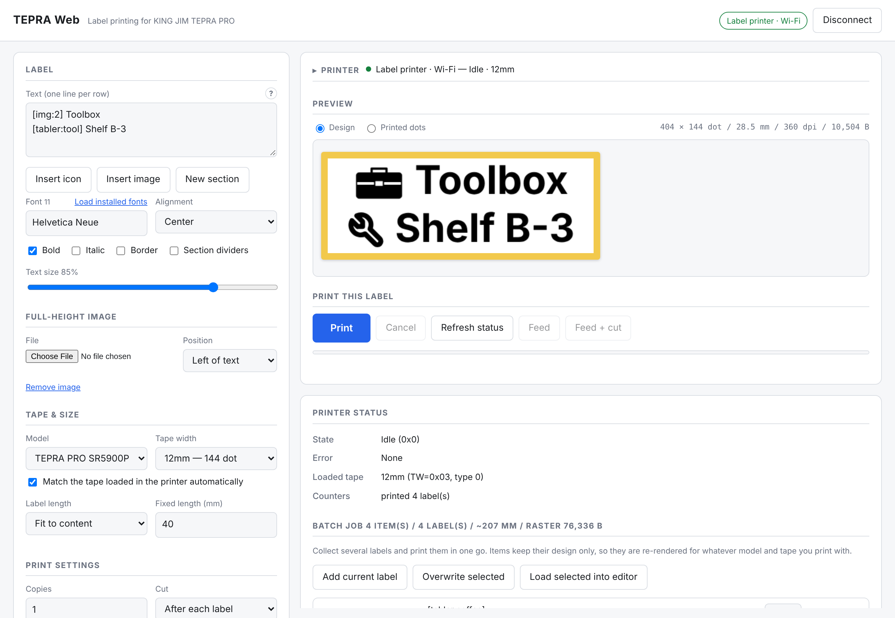
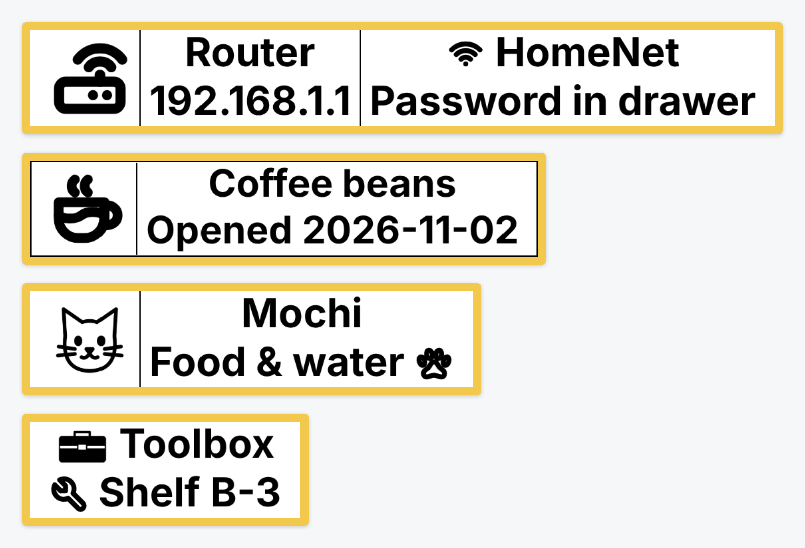
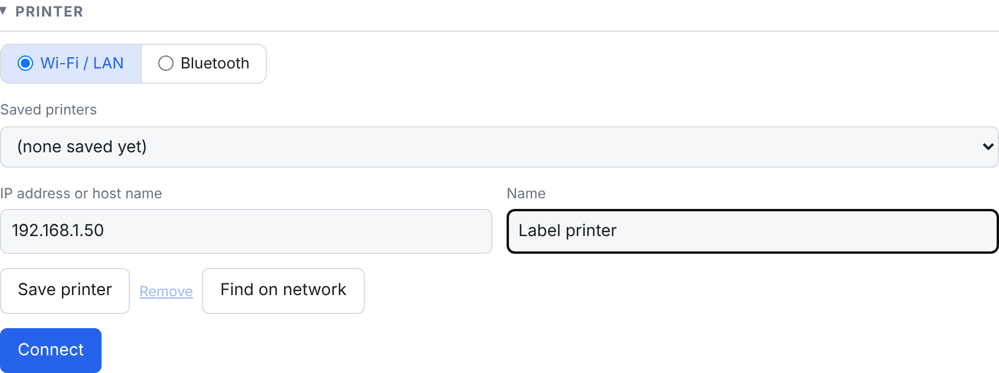
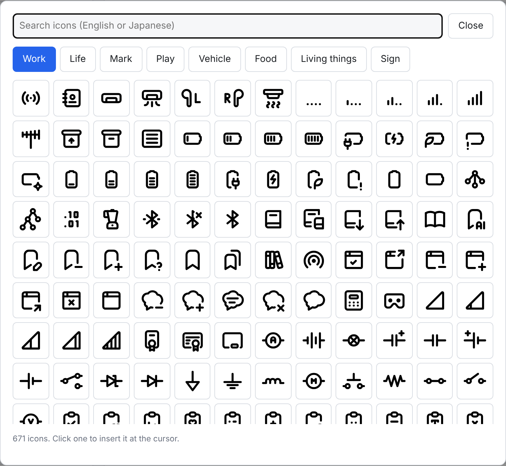
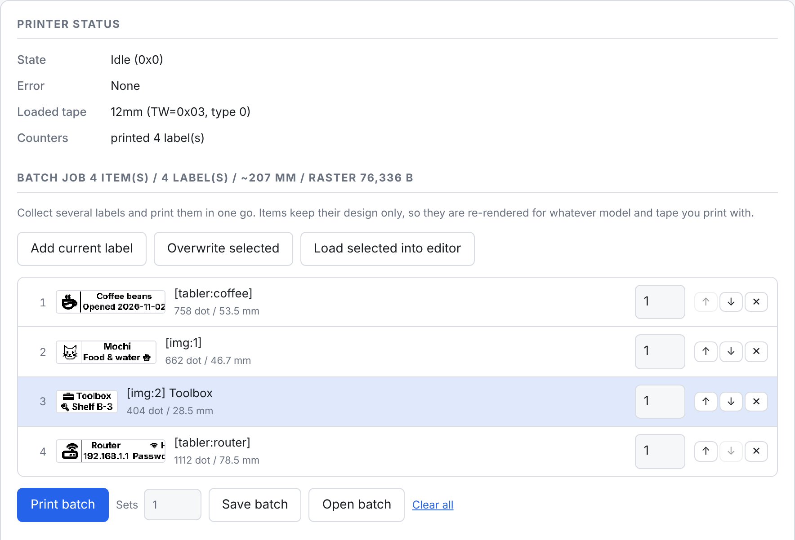
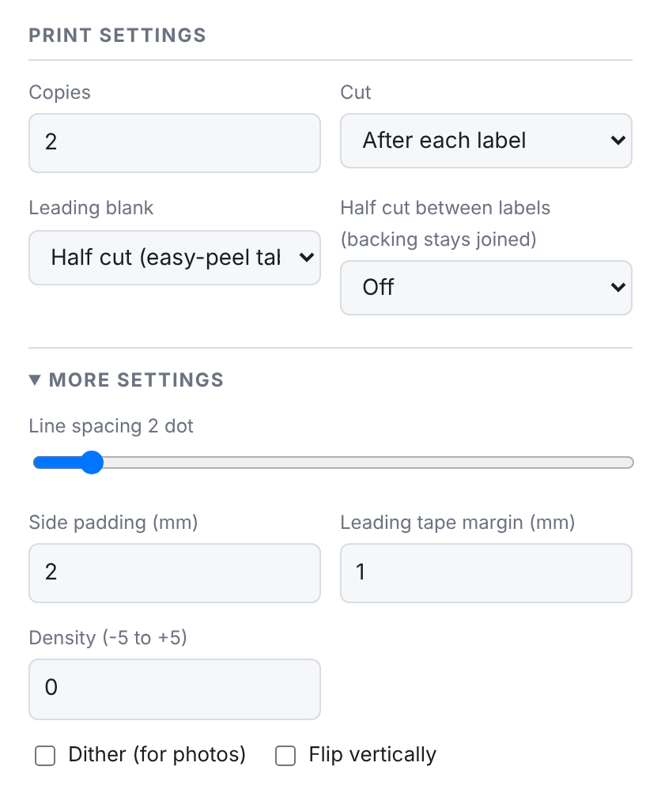

<p align="center">
  
</p>

<h1 align="center">TEPRA Web</h1>

<p align="center">
  Print labels on a KING JIM <b>TEPRA PRO</b> label printer from any browser on your home network.<br>
  No driver, no Windows PC, no phone app.
</p>

<p align="center">
  <b>English</b> · <a href="README.ja.md">日本語</a>
</p>



TEPRA Web is a small server you run at home (Docker, or plain Node.js). Open it from a laptop or
a phone, type your label, check the preview, press **Print**. It's built for the **SR5900P**
family over **Wi-Fi / LAN**.

> [!NOTE]
> **Bluetooth support is untested.** The Bluetooth code (for the SR-R2500P, SR-MK1 and
> SR-R7900P) comes from the upstream project, and I don't have the hardware to test it. It may
> work, or it may not. Reports and fixes are welcome.

## What you can make



- **Sections.** Put `---` on a line of its own and the label splits into side-by-side sections.
  Each section sizes its own text to fill the tape, so a big icon can sit next to two lines of
  text. Turn on *Section dividers* to draw a line between them.
- **Icons in the text.** About 6,000 icons, searchable in English and Japanese.
- **Your own pictures in the text.** A logo, a drawing, a photo: *Insert image* puts it at the
  cursor, as tall as the text on that line.
- **Any font** installed on your computer (Chrome / Edge), bold, italic, border, alignment, and
  a fixed or automatic label length.
- **Batch printing.** Queue up several different labels and print them in one go.

## Quick start

You need:

- A TEPRA PRO **SR5900P**, **SR5900C** or **SR5900GS** connected to your Wi-Fi or LAN
- A machine that is always on at home to run the server (a NAS, a Raspberry Pi, a home server…)
  with **Docker**, or **Node.js 18+**

### 1. Start the server

With Docker Compose (from a clone of this repository):

```bash
docker compose up -d --build
```

Then open `http://<server-ip>:8765/` in your browser.

<details>
<summary><b>Portainer</b></summary>

1. **Stacks → Add stack**
2. Choose **Repository**, point it at this Git repository, compose path `docker-compose.yml`.
   Portainer builds the image (no prebuilt image is published).
3. Optional: set `TEPRA_PRINTERS` (see [Configuration](#configuration)) so the printer is
   already there on first load.
4. Deploy, then open `http://<docker-host>:8765/`.

</details>

<details>
<summary><b>Without Docker</b></summary>

Node.js 18 or newer. No `npm install` is needed for Wi-Fi printing.

```bash
HOST=0.0.0.0 npm start
```

Without `HOST=0.0.0.0` the server only listens on `127.0.0.1`, so other devices can't reach it.

</details>

### 2. Connect the printer



1. Connect the SR5900P to your Wi-Fi or LAN with the printer's own setup tool or front panel.
2. Find its IP address in your router's list of connected devices, or click
   **Find on network**.
3. In your router, give the printer a **DHCP reservation** so its IP address never changes.
4. In TEPRA Web, under **Printer → Wi-Fi / LAN**, type the IP address and press **Connect**.
   The printer is saved for next time, and the tape width is set to the cartridge that's loaded.

Once connected, the Printer section folds into one line (name, state, loaded tape) and the
preview moves up.

> [!TIP]
> If the printer is on a separate VLAN or IoT network, allow **UDP 9100** and **TCP 9100** from
> the server to the printer.

### 3. Print

Type your text, one row per line. The preview updates as you type. Press **Print**.

The progress bar follows the job until the printer says it's finished. If something is wrong
(cover open, no tape, the wrong tape width for the label), you get a message instead of a wasted
label.

## Making labels

### Sections

A line with only `---` starts a new section (or press **New section**). The router label above
is this text ([screenshot](docs/images/en/editor-sections.png)). Each section is sized on its own, so the 1-line icon section gets the full tape
height while the 2-line sections get two smaller lines.

With **Label length → Fixed**, the text shrinks to fit the length you set.

### Icons



Press **Insert icon**, then pick one. The tabs follow TEPRA LINK 2 (Work, Life, Mark, Play,
Vehicle, Food, Living things, Sign), and the search box understands English and Japanese
([screenshot](docs/images/en/icon-search.png)).

The icon goes in at the cursor as a short code like `[tabler:coffee]` and is drawn as tall as the
text on its line. You can also type the code by hand.

Icons come from [Tabler Icons](https://tabler.io/icons), [Maki](https://github.com/mapbox/maki)
and [Phosphor](https://phosphoricons.com).

### Pictures in the text

Press **Insert image** and pick a file. It goes in at the cursor as `[img:1]`, `[img:2]`, …, on
any line of any section, and is drawn as tall as the text on that line (the toolbox and cat
pictures above are done this way; [screenshot](docs/images/en/editor-image.png)). Simple black-and-white drawings and logos print best.

Pictures are scaled down when you add them (at most 512 px tall) and saved with the label and in
batch files, so they survive a reload.

For a logo that runs the full height of the tape beside the text, use **Full-height image**
instead. Tick *Dither (for photos)* under **More settings** for photos.

### What actually gets printed

Switch the preview from **Design** to **Printed dots** to see the exact dots the printer gets
([screenshot](docs/images/en/label-dots.png)).

## Batch printing



To print several different labels in one go:

1. Design a label and press **Add current label**. Repeat for each label.
2. Set the number of copies per item, and reorder with the arrows.
3. Press **Print batch**. **Sets** prints the whole batch that many times.

**Save batch** downloads the batch as a JSON file, and **Open batch** loads it back. Items keep
only the design, so a batch made for 12 mm tape prints just as well on 18 mm. **Load selected
into editor** and **Overwrite selected** let you change an item.

The label you're editing, its print settings and the batch are kept in your browser, so a reload
or a closed tab doesn't lose them.

## Print settings



| Setting | What it does |
|---|---|
| **Copies** | How many of this label to print |
| **Cut** | *After each label*, *After the whole job*, or *Don't cut* |
| **Leading blank** | The printer feeds some blank tape before the first label. *Half cut* leaves it on as an easy-peel tab (default); *Cut off* removes it |
| **Half cut between labels** | Cuts through the label but not the backing, so the labels stay joined on one strip |
| **Density** | -5 (lighter) to +5 (darker) |
| **More settings** | Line spacing, side padding, leading tape margin, dither, flip vertically |

**Tape width** follows the cartridge in the printer while *Match the tape loaded in the printer
automatically* is ticked. You can also pick it by hand to design for a tape that isn't loaded;
the server refuses to print a label laid out for a different tape than the one in the printer.

## On your phone

On a phone the preview comes first and the **Print** button stays at the bottom of the screen
([screenshot](docs/images/en/phone.png)).
Add the page to your home screen to open it like an app.

The interface is in English and Japanese. It follows your browser's language, and you can switch
it at the bottom of the page.

## Configuration

Set these as environment variables (in `docker-compose.yml`, or in Portainer's stack settings).
All are optional.

| Variable | Default | Meaning |
|---|---|---|
| `PORT` | `8765` | HTTP port |
| `HOST` | `0.0.0.0` in Docker, `127.0.0.1` otherwise | Listen address |
| `DATA_DIR` | `/data` in Docker, `./data` otherwise | Where saved printers (`printers.json`) are kept |
| `TEPRA_PRINTERS` | – | Printers to add on start, comma-separated `Name=IP[:port][@model]`, e.g. `Label printer=192.168.1.50` or `192.168.1.50,Garage=192.168.1.51@SR5900C` |
| `TEPRA_BLUETOOTH` | `0` in Docker, on otherwise | Set to `0` to turn the Bluetooth bridge off |

The compose file uses `network_mode: host` so that *Find on network* can broadcast to the
printer. If you need bridge networking, publish `8765:8765` and type the printer's IP by hand;
printing still works, only discovery doesn't.

The container has a health check on `/healthz`. `docker-compose.yml` also has an optional
`autoheal` service (commented out) that restarts the container if it turns unhealthy.

> [!WARNING]
> The server has **no login**. Keep it on your home network and don't expose it to the internet.
> Put a reverse proxy with authentication in front of it if you need access from outside.

## Printing from scripts (image API)

Send a PNG and it gets printed, no browser needed. Handy for home automation.

```bash
curl --data-binary @label.png -H 'Content-Type: image/png' \
  'http://<server-ip>:8765/api/print/image?printer=192.168.1.50&copies=2&cut=each'
```

The image's height runs across the tape. Taller images are scaled down to fit; shorter ones are
centred.

| Param | Values |
|---|---|
| `printer` | saved printer id, name or IP (optional when only one printer is saved) |
| `copies` | 1–99 |
| `cut` | `each` (default), `end`, `none` |
| `lead` | `half` (default): half-cut the leading blank so it stays on as a peel tab; `cut`: cut it off |
| `halfcut` | `1` half-cuts between labels (they stay joined on the backing); default `0` |
| `density` | -5…5 |
| `tape` | tape code (`1`=4mm `2`=6mm `3`=9mm `4`=12mm `5`=18mm `6`=24mm `7`=36mm); default: the loaded tape |
| `fit` | `contain` (default) or `fill` (scale up to the full tape height) |
| `rotate` | `1` rotates the image 90° |
| `invert` | `1` for white-on-black |
| `padding`, `margin` | mm of padding at both ends (default 2) / leading tape margin (default 1) |

Other endpoints: `GET /api/net/status?printer=…`, `GET /api/net/discover`, `GET /api/printers`,
`GET /healthz`.

## Bluetooth (untested)

The Bluetooth Classic (RFCOMM) path for the **SR-R2500P**, **SR-MK1** and **SR-R7900P** comes
unchanged from [nikachu2012/tepra_web](https://github.com/nikachu2012/tepra_web). I don't have a
Bluetooth TEPRA, so it hasn't been tested in this fork.

It only works when the server runs **natively, not in Docker**, on the computer the printer is
paired with:

- **macOS:** needs `swiftc` (run `xcode-select --install`); a small helper is built on first use.
- **Linux / Windows:** needs the optional `bluetooth-serial-port` package (`npm install`).

Then choose **Printer → Bluetooth**, press **Scan paired devices**, pick the printer and
**Connect**. `npm run probe` checks the connection without printing anything.

## Troubleshooting

| Problem | Try this |
|---|---|
| *Find on network* finds nothing | Discovery needs `network_mode: host` and the printer on the same subnet. Type the IP instead. |
| Can't connect | Check the IP, that the printer is on, and that UDP/TCP 9100 is open from the server. Run `npm run netprobe -- <printer-ip>` on the server. |
| "Loaded tape is … but the label was laid out for …" | The label was laid out for a different tape width. Tick *Match the tape loaded in the printer automatically*, or pick the loaded tape. |
| Only a few fonts in the list | *Load installed fonts* needs Chrome or Edge over `https://` or `localhost`. Over plain `http://<lan-ip>` you get a built-in list of common fonts. |
| **Feed** / **Feed + cut** are greyed out | They are Bluetooth-only for now. On Wi-Fi, print with *Cut: After each label*. |

## Supported printers

| Printer | Connection | Status |
|---|---|---|
| SR5900P / SR5900C / SR5900GS | Wi-Fi / LAN | Supported, tested on the SR5900P |
| SR-R2500P / SR-MK1 / SR-R7900P | Bluetooth Classic | Untested (no hardware) |
| SR-R5600 series (BLE only), SR5500P | – | Not supported |

---

## For developers

### How it fits together

```
  Phone / laptop browser  ──HTTP──▶  TEPRA Web server (Node.js)  ──UDP+TCP 9100──▶  SR5900P
  (editor, preview,                  (print session, status,
   raster + command bytes)            saved printers, image API)
```

The browser lays out the label, turns it into 1-bit raster rows and builds the printer command
stream (`app/`). The server (`server/`) opens the print session with the printer and streams the
job to it. There are no runtime npm dependencies for Wi-Fi printing; `bluetooth-serial-port` is
an optional dependency used only by the Bluetooth bridge.

| Path | What's there |
|---|---|
| `index.html`, `app/` | The web UI: editor, layout (`layout.js`), raster (`raster.js`), command stream (`protocol.js`), i18n |
| `app/icons.json` | Icon data, generated by `scripts/build-icons.mjs` (see the comment at its top to update) |
| `server/index.js` | HTTP server, API, Server-Sent Events for status and logs |
| `server/network.js` | SR5900P Wi-Fi / LAN protocol |
| `server/rfcomm.js`, `server/native/` | Bluetooth bridge (macOS helper in Swift) |
| `test/` | Unit tests and a fake SR5900P |
| `PROTOCOL.md` | Full command reference (Japanese) |

### Testing without a printer

`test/fake-sr5900p.mjs` emulates an SR5900P (the UDP control protocol and the TCP job intake). It
checks every frame and checksum, and can save each printed label as an image:

```bash
npm run fake-printer -- --port 19100 --tape 5 --dump ./fake-out
```

```bash
TEPRA_PRINTERS="Fake=127.0.0.1:19100" npm start
```

The screenshots in this README were taken against this fake printer.

```bash
npm test                                   # protocol, packets, PNG, print session, i18n, text layout
npm run netprobe -- 192.168.1.50           # talk to a real printer: status only, prints nothing
npm run netprobe -- 192.168.1.50 --test    # prints a 30 mm test pattern
npm run netprobe -- 192.168.1.50 --test --lead cut --t-margin   # old cut behaviour, for comparison
npm run netprobe -- --discover
```

`npm run netprobe` is the quickest first check against real hardware. It shows the raw 20-byte
status and whether the tape is detected. With `--test` it also prints the `C` (cut) frame it
sends. `--lead cut` cuts the leading blank off instead of half-cutting it, `--halfcut` and
`--copies N` try half cuts between labels, and `--t-margin` sends the leading margin in the `T`
command the way the official software does instead of as blank rows.

### How Wi-Fi printing works

The SR5900 family listens on port 9100 for both UDP and TCP. Every UDP packet begins with a
32-byte header: `"TPRT"`, `0`, `1`, `0x20`, command, payload length, then two zero words. All
fields are big-endian u32. Replies use `"tprt"`.

| UDP command | Reply | Meaning |
|---|---|---|
| `0x0001` | 20-byte status | `[1]` state (2 = printing), `[2]` error, `[3]` tape code, `[12..13]` labels printed |
| `0x0002` | `02 00 00` | start / lock the print session |
| `0x0101`, `0x0100` | –, `10` | announce the data stream |
| `0x0003` | `03 00 00` | end / unlock the session |

One print is: status (must be idle, no error, matching tape) → lock → TCP connect →
`0x0101` / `0x0100` → write the job → poll status until done → unlock → close TCP. The data
connection stays open for the whole session, and the server always unlocks, even after an error.
The job on TCP is the normal TEPRA command stream (`@ {ST C D G | L T H s raster FF | … @`),
byte-for-byte what the official software sends. `test/network.test.mjs` checks this against the
capture in hikalium/sr5900p. See `server/network.js` and `buildNetworkJobBytes()` in
`app/protocol.js`.

The full command reference (Japanese) is in [PROTOCOL.md](PROTOCOL.md).

### Known limitations

- **Feed** and **Feed + cut** are Bluetooth-only. The Wi-Fi sequence for them hasn't been
  captured yet.
- Discovery uses broadcast, so it only works with host networking on the same subnet.
- SR-R5600 series printers (BLE only) and the SR5500P are not supported.

## Credits

- [nikachu2012/tepra_web](https://github.com/nikachu2012/tepra_web) (MIT): the editor, the
  raster/command generation reverse-engineered from TEPRA LINK 2, and the Bluetooth bridge. This
  project is built on that code.
- [takonomura/tepra-web](https://github.com/takonomura/tepra-web) and
  [hikalium/sr5900p](https://github.com/hikalium/sr5900p) (MIT): the SR5900P Wi-Fi protocol
  (UDP control packets and session sequence), based on
  [Mine02C4's analysis](https://github.com/Mine02C4/TEPRA_PRO_SR5900P_analysis). The network
  transport here is a fresh JavaScript implementation of that protocol.
- Icons: [Tabler Icons](https://tabler.io/icons) (MIT), [Maki](https://github.com/mapbox/maki)
  (CC0) and [Phosphor Icons](https://phosphoricons.com) (MIT), without their brand logos. See
  [THIRD_PARTY_LICENSES.md](THIRD_PARTY_LICENSES.md).

Licensed under the [MIT License](LICENSE).

This is an unofficial tool and is not affiliated with KING JIM.
